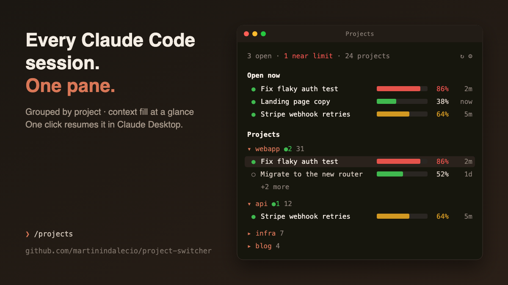

# project-switcher

**See every Claude Code session you have, grouped by project, with how full each context window is. Click one to jump back in.**

[](LICENSE)




<sub>Illustration of the pane. The real one draws with your terminal's or Claude Desktop's own colours.</sub>

When you run Claude Code in several repos at once, sessions are hard to keep track of. Which one was I in? Which one is about to hit the context limit? project-switcher adds a **Projects** pane that answers both questions, and one click resumes any session in Claude Desktop, Terminal or iTerm.

## Quick start

```bash
git clone https://github.com/martinindalecio/project-switcher ~/claude/claudemods/project-switcher
```

```bash
claude --plugin-dir ~/claude/claudemods/project-switcher
```

Then type `/projects`. To load it in every session, see [Install](#install).

## What you get

Plain-text view of the same pane:

```
2 open · 1 near limit · 24 projects · now              ↻ ⚙

Open now
  ● Fix flaky auth test              ▰▰▰▰▰▰▰▱  86%  2m
  ● Landing page copy                ▰▰▰▱▱▱▱▱  38% now

Projects
▾ webapp ●2 31
  ● Fix flaky auth test              ▰▰▰▰▰▰▰▱  86%  2m
  ○ Migrate to the new router        ▰▰▰▰▱▱▱▱  52%  1d
    +2 more
▸ api 12
```

- Lists every project under `~/.claude/projects`, newest first.
- Each session row shows a context-fill bar, a percentage and when it was last active.
- `●` marks a session running right now, in Claude Desktop or a terminal.
- **Click a session** to open it in Claude Desktop (default), Terminal or iTerm.
- It refreshes when a message finishes in any session, so there is no UI polling.
- It runs in the terminal CLI and in the Claude Desktop Code tab.

## Requirements

- macOS. It uses `ps`, `lsof`, `open` and `osascript`.
- `python3` on your `PATH`.
- Claude Code with plugin hooks, version 2.1.286 or later.

## Install

```bash
git clone https://github.com/martinindalecio/project-switcher ~/claude/claudemods/project-switcher
```

To load it in every session, add this to `~/.claude/settings.json`:

```json
{ "env": { "CLAUDE_CODE_PLUGIN_DIRS": "~/claude/claudemods/project-switcher" } }
```

To try it in a single session:

```bash
claude --plugin-dir ~/claude/claudemods/project-switcher
```

Start a **new** session after installing or updating. Desktop sessions do not reload plugin code that changes underneath them.

## Use

Click **▤ Projects** above the prompt, or type `/projects`, to open the pane and rescan.

The pane follows you: once you open it, every other session you start or switch to in Claude Desktop opens it too. It stops when you close it by hand. The `▤ Projects` launcher shows only while the pane is closed.

- Click a project name to fold it or unfold it.
- `+N more` shows the rest of that project's recent sessions.
- `↻` rescans now.
- `⚙` shows the settings.

What a click on a session does:

| Session state | Open in **Desktop** | Open in **Terminal / iTerm** |
| --- | --- | --- |
| not running | Claude Desktop takes it over and shows it | a new window runs `cd <cwd> && claude --resume <id>` |
| running in Claude Desktop | switches to it | refused with a toast, so it doesn't get a second writer |
| running in a terminal | refused with a toast, so it doesn't get a second writer | refused with a toast |

Opening in Desktop uses the app's `claude://resume?session=<id>` link. The session then shows up in Desktop's sidebar.

## Settings

Change them from the pane's `⚙` section, or from `/config` in the terminal CLI. Each change takes effect at once.

| Setting | Default | What it does |
| --- | --- | --- |
| Open sessions in | `desktop` | `desktop`, `terminal` or `iterm` |
| Open the pane when a session starts | off | When on, it opens in every new session. When off, it reopens only while you left it open |
| Launcher above the prompt | on | Shows a `▤ Projects` button while the pane is closed |
| Sessions shown per project | 3 | Rows shown before `+N more` |
| Projects shown | 8 | Projects listed before `Show N more projects` |
| Context warning at | 60% | Fill at which a session turns yellow |
| Context danger at | 75% | Fill at which a session turns red and counts as "near limit" |

The values are stored in `~/.claude/settings.json` under `pluginConfigs`.

## How it works

| Path | What |
| --- | --- |
| `.claude-plugin/plugin.json` | Manifest, including the settings (`userConfig`) |
| `hooks/register.tsx` | Hooks for the pane render, `/projects`, the settings and the scanner lifecycle |
| `bin/scan.py` | Reads transcript heads and tails for title and token usage, and matches running `claude` processes. `once` prints one snapshot; `watch` prints a new one whenever a session's turn ends. |
| `types/index.d.ts` | Types for the plugin's state |
| `tests/pane.test.tsx` | Mount tests on the terminal and desktop surfaces |

Context fill is the last assistant message's input and cache tokens divided by the model's window. The window is 1M for `[1m]` models or anything over 200k, and 200k otherwise.

## Troubleshooting

- **The pane is blank or doesn't appear.** Run `/projects` in a new session. Panes opened by a command appear at any width.
- **Clicking a session does nothing.** Check the toast. For Desktop, Claude.app must be installed. For iTerm, macOS may ask you once to allow automation.
- **Debug log:** run `claude --debug` and look for lines starting with `project-switcher:`.

## Develop

```bash
claude plugin validate .
```

```bash
claude plugin test .
```

Issues and pull requests are welcome. Linux support (it needs `/proc` instead of `lsof`, and another way to open a terminal) would be a good first contribution.

## License

[MIT](LICENSE)
